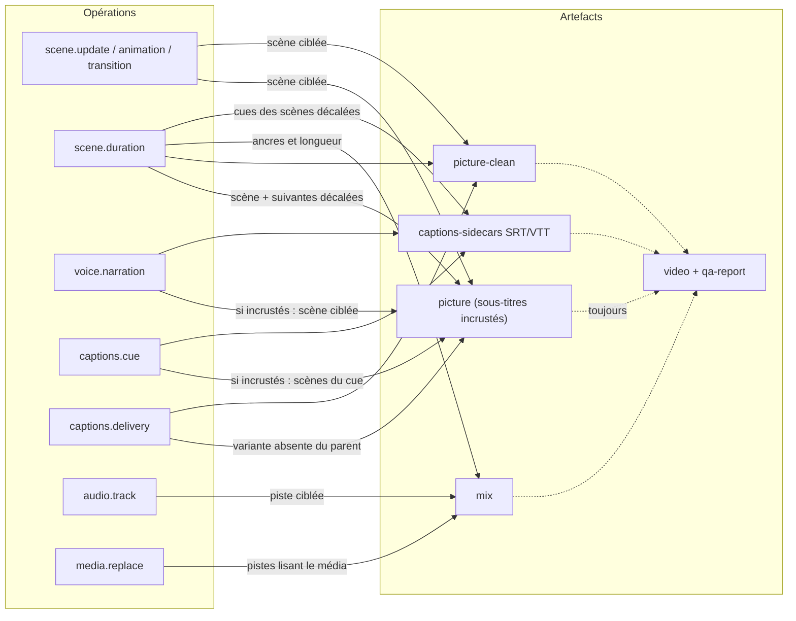

# Opérations d'édition et invalidation des artefacts (T128)

Statut : **implémenté le 2026-11-10** (T128, [D025](../DECISIONS.md#d025--editoperation-et-invalidation)).
Contrat : `packages/schemas/src/edits.ts` (`editOperationSchema`, `invalidationPlanSchema`).
Application et plan : `apps/studio/src/lib/server/edits.ts` (`applyEdits`, `invalidationPlan`).
Outil : `revision.apply` ([TOOL-REGISTRY § 3 bis](TOOL-REGISTRY.md)).

## 1. Opérations

Union discriminée sur `op` ; chaque variante cible des identifiants précis et réutilise un
contrat existant (aucun champ libre appliqué comme code).

| `op` | Cible | Valeur (contrat réutilisé) | Effet |
|---|---|---|---|
| `scene.update` | `sceneId` | `patch` : `text`, `params` (`scenePatchSchema`) | texte ou champ principal et paramètres du composant |
| `scene.animation` | `sceneId` | `animationMs` (`scenePatchSchema`) | durée de l'animation d'entrée |
| `scene.transition` | `sceneId` | `enter` : `fade`, `slide-up`, `scale` (`scenePatchSchema`) | transition d'entrée (seule transition du compositeur ; pas de fondu croisé entre scènes) |
| `scene.duration` | `sceneId` | `durationMs` (`scenePatchSchema`) | les scènes suivantes sont décalées (`applyProposal`) |
| `media.replace` | `assetId` | `withAssetId` (audio valide du même projet) | toutes les pistes qui lisent ce média lisent l'autre |
| `audio.track` | `trackId` | `patch` (`audioMixPatchSchema`) | gain, fondus, ducking, ancre |
| `voice.narration` | `sceneId` | `text` ou `null` (`sceneNarrationSchema`) | narration ; sous-titres de la scène reconstruits (temps `scene`) |
| `captions.cue` | `cueId` | `lines` (`captionCueSchema`) | lignes affichées d'un cue |
| `captions.delivery` | — | `mode` : `burned`, `clean`, `both` | incrustés, exportés seulement (vidéo propre + SRT/VTT), ou les deux |

Pas de « rush » vidéo ou image aujourd'hui : le storyboard ne référence aucun média visuel
(import vidéo prévu en v0.5). `media.replace` porte donc sur les médias audio importés
(musique, voix, ambiance). La voix enregistrée ou générée se remplace par `media.replace`
sur l'`assetId` de sa piste ; la synthèse reste un outil séparé.

Exemples valides :

```json
[
  { "op": "scene.update", "sceneId": "scn_…", "patch": { "text": "Nouveau titre" } },
  { "op": "scene.duration", "sceneId": "scn_…", "durationMs": 4000 },
  { "op": "media.replace", "assetId": "ast_old", "withAssetId": "ast_new" },
  { "op": "audio.track", "trackId": "atr_music", "patch": { "gainDb": -6 } },
  { "op": "captions.cue", "cueId": "cue_0003", "lines": ["Texte corrigé"] },
  { "op": "captions.delivery", "mode": "clean" }
]
```

Refusés par le schéma (`invalid-input`, aucune écriture) : opération inconnue
(`scene.delete`), identifiant d'un autre type, patch vide, champ d'une autre opération
(`scene.update` avec `durationMs`), valeur hors bornes (durée < 1000 ms, gain > 12 dB),
clé supplémentaire, ligne de sous-titre avec saut de ligne. Liste complète :
`packages/schemas/src/edits.test.ts`.

## 2. Application (tout ou rien)

`applyEdits(parent, operations)` travaille sur une copie ; la première erreur arrête tout :

- **`conflict`** : deux opérations du même type sur la même cible ; scène, piste, cue ou
  média absent ; média de remplacement inconnu, d'un autre projet ou invalide ; cue
  reconstruit par une autre opération du lot (narration ou durée de sa scène) ; révision
  parente non modifiable (pas `awaiting_approval`) ou non à jour (elle a déjà un enfant).
- **`invalid-input`** : résultat refusé par les règles existantes (`params` sur une scène
  sans composant, durée maximale dépassée, durée incompatible avec le composant).

Ordre : scènes (`applyProposal`), narration, sous-titres (`refreshCaptions`, même règle que
`Studio.newRevision` ; première narration → piste de repli comme `setNarration`), cues,
audio (fusion d'`audio.track.update`, puis `media.replace`), livraison.

## 3. Ce qui est réellement réutilisé

Un seul mécanisme existe : `RenderJobRunner.reusablePicture` recopie l'**image muette** du
parent. Sa règle est la fonction pure `reusableVariant` (`jobs/runner.ts`), utilisée telle
quelle par le plan : storyboard identique hors narration (`pictureKey`) et, pour l'image
incrustée, sous-titres identiques. Le fichier du parent est vérifié au rendu.

Tout le reste est **invalidé** à chaque rendu, faute de mécanisme de réutilisation (D019 :
pas de cache entre runs ; T130 : cache par scène à décider) : composition et rendu de toutes
les scènes dès que l'image change, mixage et mux, SRT/VTT, rapport QA. Le plan distingue
la cause : `operation` (l'édition change l'artefact), `no-reuse-mechanism` (reconstruit
quand même), `parent-lacks-variant` (variante jamais rendue par le parent, par ex. vidéo
propre après passage de `burned` à `both`). La liste `scenes` (`content`, `timing`,
`captions`, `unchanged`) dit quelles scènes l'édition change réellement ; elle prépare T130
mais ne permet pas aujourd'hui de rendre une scène seule.

## 4. Graphe d'invalidation



Une flèche pleine = invalidé par l'opération (sinon `picture`/`picture-clean` sont
**réutilisés** depuis le parent) ; pointillés = reconstruit à chaque rendu.

Règles vérifiées (`apps/studio/src/lib/server/edits.test.ts`) :

| Édition | Images | Autres |
|---|---|---|
| musique seule (`audio.track`) | réutilisées (incrustée et propre) | `mix` (piste ciblée) |
| sous-titre incrusté (`captions.cue`, `burned`/`both`) | `picture` des scènes du cue ; `picture-clean` réutilisée | SRT/VTT |
| sous-titre exporté seul (`captions.cue`, `clean`) | `picture-clean` réutilisée | SRT/VTT seulement |
| remplacement d'un média (`media.replace`) | réutilisées | `mix` (pistes qui le lisent) |
| modification d'une scène (`scene.update`) | scène ciblée ; autres `unchanged` (mais rendues à nouveau, pas de cache par scène) | — |
| durée (`scene.duration`) | scène + suivantes (`timing`) | `mix` (toutes les pistes), SRT/VTT |

## 5. Outil `revision.apply`

Entrée `{ revisionId, operations: EditOperation[1..50] }`, permission
`writes-revision-artefacts`, portée `ctx.revision(id)`. Crée une révision enfant **`draft`**
(dépôt, transaction ; contrôle « parent à jour » refait dans la transaction) ; la révision
parente n'est pas modifiée, **ni son état** (contrairement à `Studio.startEdit` qui la passe
`changes_requested`). Trace dans `resolvedConfig.origin` : `tool`, `parentRevisionId`,
`operations`, `invalidation`. Sortie : `revisionId`, `parentRevisionId`, `invalidation`,
`warnings`. **Aucun rendu** : l'orchestrateur (T129) crée le job de rendu ; le test
`tools.test.ts` le fait à la main et constate `videoReusedFrom` = parent, comme prévu.
