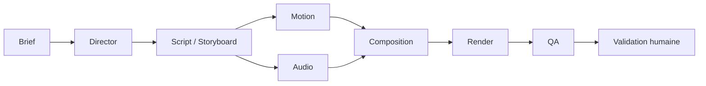

# Architecture multi-agents — v0.3

La phase A a livré les contrats et événements visuels ; la phase B le moteur
audio. La phase C intègre les runs persistés dans le service Studio.
**agents ≠ sous-agents Claude Code (.claude/agents)**.

## Rôles et frontières

- **Director** : seul orchestrateur de décision ; organise les phases, les
  dépendances et les budgets. Ne rend jamais de vidéo et ne mixe jamais de son.
- **Motion** : réutilise `@veyra/motion`, ses cinq composants et leurs paramètres.
- **Audio** : travaille sur des fichiers existants référencés par asset ; aucun
  TTS payant. Produit des pistes et des instructions de mixage.
- **Review** : réutilise les commentaires, lots et plans de correction existants.
- **QA Expert** : expertise indépendante ; ne valide jamais comme indépendant
  ce que son propre fournisseur a produit comme créateur. Dans les modes
  `fake`/`claude-subscribe`, le même fournisseur peut créer et évaluer : cette
  évaluation reste consultative et la validation humaine demeure obligatoire.

Les opérations déterministes restent dans les moteurs : résolution des ancrages,
composition, mixage, rendu, mesures et validation des contrats. Les phases
`composition` et `render` appartiennent à `engine`, `human-approval` à `human`.

## Contrats partagés

Tous sont réexportés par `packages/schemas/src/index.ts`.

| Fichier                                          | Contrats                                                                                                                                                                                                |
| ------------------------------------------------ | ------------------------------------------------------------------------------------------------------------------------------------------------------------------------------------------------------- |
| `packages/schemas/src/core.ts`                   | Contrats existants inchangés, IDs (dont `atr`, `run`, `phs`), storyboard, révision, feedback, plan, qualité et transitions                                                                              |
| `packages/schemas/src/production.ts`             | Agents, phases, brief, plan de production, alias `storyboardSpecification`, composition motion, plan de revue étendu et enveloppe générique ; réexport du rapport qualité existant |
| `packages/schemas/src/audio.ts`                  | Catégories, pistes, composition audio et patches de mixage ; sans moteur                                                                                                                                |
| `packages/schemas/src/timeline.ts`               | Événements, ancrages, résolution, construction des champs frame et garde CFR                                                                                                                            |
| `packages/schemas/src/frames.ts`                 | Unique système de conversion temporelle, FPS rationnels                                                                                                                                                 |
| `packages/motion/src/registry.ts`, `timeline.ts` | Événements relatifs validés et `visualTimeline` absolue                                                                                                                                                 |

L'enveloppe `agentResultSchema(payloadSchema)` contient `id` (`phs_*`),
`schemaVersion: 1`, `agent`, `phase`, `revisionId` nullable, `dependsOn` (résultats
`phs_*`), `provider`, `provenance` (`inputHash`, `createdAt` en ms Unix, `model`
nullable), `warnings`, `errors`, `validation` et `payload` typé. Les états de
validation sont `pending`, `valid`, `invalid`, `needs-human`. Le hash SHA-256 de
JSON aux clés triées sert à l'idempotence ; l'ordre des tableaux reste significatif.
Les entrées non JSON sont rejetées. Le hash utilise `node:crypto` côté moteur Node.

Précisions (D019) : `agent` vaut un agent métier, `engine` ou `human`, comme dans
le plan. Le contrat du script est `StoryboardDraft` (`@veyra/ai`) ; l'ancien
`scriptSpecificationSchema`, inutilisé, a été retiré. `inputHash` est exporté par
`@veyra/schemas/hash` (serveur uniquement) pour que `node:crypto` n'entre pas dans
le bundle client. Le hash est une provenance : l'idempotence se limite à ne jamais
rejouer une phase terminée dans son run ; aucun cache entre runs.

## Temps audiovisuel et priorité des ancrages

Les temps absolus sont en millisecondes ; les événements des composants sont en
secondes relatives à la scène. `visualTimeline` utilise le contexte de `compose`
(durée, entrée par défaut 0,5 s, dimensions, palette) et conserve les décimales.
Les IDs d'événements sont `${sceneId}:${name}:${index}`, indépendants de la position
ou de l'ordre de la scène. Stagger et répétitions font partie des durées des
événements ; les compteurs suivent leurs animations numériques.

Les frames proviennent exclusivement de `frameAt` et `frameCount` dans `frames.ts`,
avec un `FrameRate` explicite (30/1 ou 30000/1001, par exemple). `endFrame` désigne
la frame affichée à `endMs`, bornée à la dernière frame, pas une borne exclusive.
CFR est supposé ; `assertConstantFrameRate` rejette un média explicitement VFR
avec « fréquence variable non prise en charge ». Un média inconnu n'est pas une
preuve de CFR et doit être mesuré par le futur moteur.

Le runner enregistre `constantFrameRate` mesuré par `probe` (débit nominal égal au
débit moyen ; les rendus HyperFrames observés sont en 30/1) ; une valeur non
mesurée vaut `false`. `Studio.addAnnotation` refuse un média VFR avant tout
indexage de frame. Le `fps` du storyboard est une valeur d'auteur, arrondie ; le
débit rationnel des frames vient toujours du média mesuré.

Chaque cue possède **exactement un ancrage**, sans mélange ni priorité implicite :

- `absolute` : position fixe, ne suit aucun déplacement de scène.
- `event` : scène stable, nom, index (0 par défaut), bord début/fin (début par
  défaut), décalage entier éventuellement négatif. Résolu à chaque composition,
  il suit l'événement et donc la scène déplacée entre révisions.
- Événement manquant : erreur de synchronisation `event-missing`, jamais de repli
  silencieux vers une position absolue. Résultat négatif : `before-zero` ; après
  la fin : `after-end`.

Pour la résolution, la fin est le maximum des fins des événements `scene` ; en
leur absence, le maximum des fins des événements disponibles, ou zéro pour une
liste vide. Les deux bornes sont incluses. Fournir la timeline complète de la
composition, et non un sous-ensemble filtré.

Les fenêtres de ducking (`duck`) sont en temps absolu : une correction qui change
une durée de scène alors que la bande son source en contient ajoute l'avertissement
« fenêtres d'atténuation en temps absolu : vérifier après décalage des scènes » et
la phase plan passe `needs-human`. Avant le rendu, la phase composition résout
chaque ancrage sur `visualTimeline` du nouveau storyboard ; un ancrage inrésolu
devient un avertissement `needs-human`, sans bloquer.

Une piste utilise la source depuis `sourceInMs` ; sans `durationMs`, jusqu'à la fin
connue de la source. Seule la musique peut boucler. Les patches ne réinitialisent
pas les champs omis. L'application des fades, du ducking, des gains et de la cible
LUFS appartient au moteur audio, pas aux agents.

## Orchestration persistée dans Studio (phase C)

`apps/studio/src/lib/server/production.ts` exécute les dépendances du plan et
persiste chaque résultat dans une enveloppe avec fournisseur, hash et validation.
Les phases indépendantes Motion/Audio démarrent ensemble, avec des IDs de scènes
communs et stables dans le run. Une phase sans runner attend une entrée externe.
Les phases réussies ne sont pas rejouées à la reprise ; les échecs sont retentés
dans la limite du plan et du budget d'appels IA. La création du run et la
persistance des résultats sont transactionnelles. Un rendu en échec reprend
dans une révision enfant, sans rouvrir la révision échouée. L'arrêt laisse finir les phases
en cours ; la reprise attend leur fin. Les appels concurrents à `drive` d'une même
instance partagent la même exécution (pas de coordination multi-processus).

Chaque payload est validé par le contrat de sa phase avant persistance (plan :
`productionPlanSchema`, ou plan de revue / composition audio pour une révision ;
script : `StoryboardDraft` ; motion : `motionCompositionSchema` avec
`registryVersion` ; audio : `audioCompositionSchema`). Un écart fait échouer la
phase avec une erreur en français et conserve l'enveloppe `invalid` et ses
`errors`. Après un arrêt brutal du processus, un run resté `running` sans
exécution en mémoire peut reprendre : ses phases `running` passent `failed` puis
`pending`. La phase render suit la révision issue de sa cible (enfants de rendu
automatique) et applique `budget.maxRenders` aux rendus des révisions du run.

`Studio.sendPrompt` crée le brief et le plan ; l'import assisté complète le script.
Les anciens exports sans run créent un run lors de l'import. Les révisions
conservent le plan de correction ou la composition audio manuelle dans le résultat
de la phase plan, et la révision source dans le run : `resumeProduction` reconstruit
ainsi ses runners depuis SQLite. Les corrections audio seules omettent Motion et
réutilisent l'image via le moteur existant. Les commentaires transmettent plage
temporelle et piste audio au fournisseur ; les IDs proposés sont filtrés.

Le résumé QA reste `needs-human`. L'approbation, ou la demande de changements sur
la révision source, complète la phase d'attente humaine. Aucun run ne publie.
Le snapshot expose runs et phases ; cette phase ne crée pas de commandes UI.
Preuves et avancement : T084–T086 dans [TASKS](../TASKS.md).
