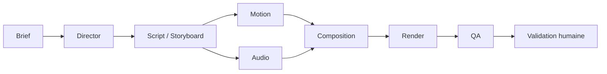

# Architecture multi-agents — v0.3, phase A

Cette phase livre des contrats purs et des événements visuels ; elle ne crée
ni orchestrateur opérationnel, ni stockage, ni interface, ni moteur audio.
**agents ≠ sous-agents Claude Code (.claude/agents)**.

## Rôles et frontières

- **Director** : seul orchestrateur de décision ; organise les phases, les
  dépendances et les budgets. Ne rend jamais de vidéo et ne mixe jamais de son.
- **Motion** : réutilise `@veyra/motion`, ses cinq composants et leurs paramètres.
- **Audio** : travaille sur des fichiers existants référencés par asset ; aucun
  TTS payant. Produit des pistes et des instructions de mixage.
- **Review** : réutilise les commentaires, lots et plans de correction existants.
- **QA Expert** : expertise indépendante ; ne valide jamais comme indépendant
  ce que son propre fournisseur a produit comme créateur. Dans les modes
  `fake`/`claude-subscribe`, le même fournisseur peut créer et évaluer : cette
  évaluation reste consultative et la validation humaine demeure obligatoire.

Les opérations déterministes restent dans les moteurs : résolution des ancrages,
composition, futur mixage, rendu, mesures et validation des contrats. Les phases
`composition` et `render` appartiennent à `engine`, `human-approval` à `human`.

## Contrats partagés

Tous sont réexportés par `packages/schemas/src/index.ts`.

| Fichier                                          | Contrats                                                                                                                                                                                                |
| ------------------------------------------------ | ------------------------------------------------------------------------------------------------------------------------------------------------------------------------------------------------------- |
| `packages/schemas/src/core.ts`                   | Contrats existants inchangés, IDs (dont `atr`, `run`, `phs`), storyboard, révision, feedback, plan, qualité et transitions                                                                              |
| `packages/schemas/src/production.ts`             | Agents, phases, brief, plan de production, script, alias `storyboardSpecification`, composition motion, plan de revue étendu, enveloppe générique et `inputHash` ; réexport du rapport qualité existant |
| `packages/schemas/src/audio.ts`                  | Catégories, pistes, composition audio et patches de mixage ; sans moteur                                                                                                                                |
| `packages/schemas/src/timeline.ts`               | Événements, ancrages, résolution, construction des champs frame et garde CFR                                                                                                                            |
| `packages/schemas/src/frames.ts`                 | Unique système de conversion temporelle, FPS rationnels                                                                                                                                                 |
| `packages/motion/src/registry.ts`, `timeline.ts` | Événements relatifs validés et `visualTimeline` absolue                                                                                                                                                 |

L'enveloppe `agentResultSchema(payloadSchema)` contient `id` (`phs_*`),
`schemaVersion: 1`, `agent`, `phase`, `revisionId` nullable, `dependsOn` (résultats
`phs_*`), `provider`, `provenance` (`inputHash`, `createdAt` en ms Unix, `model`
nullable), `warnings`, `errors`, `validation` et `payload` typé. Les états de
validation sont `pending`, `valid`, `invalid`, `needs-human`. Le hash SHA-256 de
JSON aux clés triées sert à l'idempotence ; l'ordre des tableaux reste significatif.
Les entrées non JSON sont rejetées. Le hash utilise `node:crypto` côté moteur Node.

## Temps audiovisuel et priorité des ancrages

Les temps absolus sont en millisecondes ; les événements des composants sont en
secondes relatives à la scène. `visualTimeline` utilise le contexte de `compose`
(durée, entrée par défaut 0,5 s, dimensions, palette) et conserve les décimales.
Les IDs d'événements sont `${sceneId}:${name}:${index}`, indépendants de la position
ou de l'ordre de la scène. Stagger et répétitions font partie des durées des
événements ; les compteurs suivent leurs animations numériques.

Les frames proviennent exclusivement de `frameAt` et `frameCount` dans `frames.ts`,
avec un `FrameRate` explicite (30/1 ou 30000/1001, par exemple). `endFrame` désigne
la frame affichée à `endMs`, bornée à la dernière frame, pas une borne exclusive.
CFR est supposé ; `assertConstantFrameRate` rejette un média explicitement VFR
avec « fréquence variable non prise en charge ». Un média inconnu n'est pas une
preuve de CFR et doit être mesuré par le futur moteur.

Chaque cue possède **exactement un ancrage**, sans mélange ni priorité implicite :

- `absolute` : position fixe, ne suit aucun déplacement de scène.
- `event` : scène stable, nom, index (0 par défaut), bord début/fin (début par
  défaut), décalage entier éventuellement négatif. Résolu à chaque composition,
  il suit l'événement et donc la scène déplacée entre révisions.
- Événement manquant : erreur de synchronisation `event-missing`, jamais de repli
  silencieux vers une position absolue. Résultat négatif : `before-zero` ; après
  la fin : `after-end`.

Pour la résolution, la fin est le maximum des fins des événements `scene` ; en
leur absence, le maximum des fins des événements disponibles, ou zéro pour une
liste vide. Les deux bornes sont incluses. Fournir la timeline complète de la
composition, et non un sous-ensemble filtré.

Une piste utilise la source depuis `sourceInMs` ; sans `durationMs`, jusqu'à la fin
connue de la source. Seule la musique peut boucler. Les patches ne réinitialisent
pas les champs omis. L'application des fades, du ducking, des gains et de la cible
LUFS appartient au futur moteur audio, pas aux agents.
